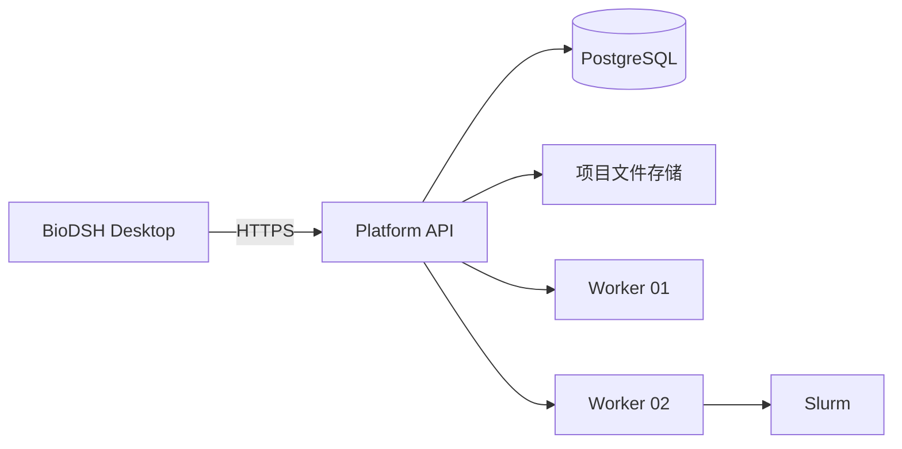

# BioDSH 多用户与多服务器开发路线

> 本路线受 [产品化工程规范](engineering-standards.zh.md) 约束。每一步都按最终上线设计，阶段验收必须同时覆盖配置、安全、迁移、测试、可观测性、部署和回滚。

## 目标架构

BioDSH 保留 React + Tauri 桌面客户端，新增 FastAPI 单体控制平台、PostgreSQL 数据库和部署在每台计算服务器上的轻量 Worker。平台统一管理用户、项目、数据、计算节点、任务、技能版本和审计信息。正式计算通过固定版本的脚本、容器或 Nextflow 工作流执行。

## 七步开发顺序

1. **统一平台后端**：建立 FastAPI、PostgreSQL、项目、节点、任务、事件、健康检查和桌面连接配置。
2. **多用户与权限**：增加账号、短期访问令牌、项目成员和管理员/负责人/分析员/只读角色。
3. **远程数据管理**：增加分片续传、服务器路径登记、文件指纹、结果浏览和项目数据隔离。
4. **多服务器调度**：开发 Worker、节点心跳、PostgreSQL 队列、资源匹配、取消重试和 Slurm 执行器。
5. **环境与技能版本**：统一技能包格式、输入输出 Schema、Apptainer/Conda 环境、节点同步和回滚。
6. **生信工作流扩展**：先完成端到端单细胞流程，再增加 Bulk RNA-seq、重测序、空间组学等流程。
7. **验证与运维**：建立单元测试、小数据基准、端到端测试、科学基准、运行指纹、监控和发布体系。

## 简化原则

- 第一版使用单体后端，不拆微服务。
- 第一版使用 PostgreSQL `FOR UPDATE SKIP LOCKED` 管理队列，不引入 Redis、RabbitMQ 或 Kafka。
- 当前单服务器部署使用本地文件目录；多台服务器共享 NAS/NFS 时直接复用目录。
- 只有出现跨机房或对象存储需求后才增加 S3/MinIO。
- 第一版不引入 Kubernetes。
- AI 负责理解需求和解释结果，确定性工作流负责正式分析。

“简单”指减少不必要的组件，不代表写死地址、密钥、路径、资源参数或业务规则。部署差异通过类型化配置表达，业务差异通过数据库、策略和版本化接口表达。

## 阶段一验收

- 桌面端可以保存平台地址和令牌并检测连接。
- 平台能够创建和查询项目。
- 计算节点可以注册和更新心跳。
- 平台能够创建、查询和取消任务。
- 每个任务拥有顺序化事件记录。
- 数据库迁移能够升级和回滚。
- API 测试、Python 代码检查和桌面 TypeScript 检查通过。
- 生产配置缺失或不安全时启动失败，所有部署参数从环境注入。
- 对外接口使用 `/api/v1` 版本契约，并保留独立存活、就绪检查。
- CI 自动执行平台检查、测试和桌面类型检查。

## 第二阶段发布门禁

当前实现状态（2026-09-14）：数据库模型、认证与令牌轮换、四级角色、项目级授权、管理员初始化、审计记录、桌面登录和系统安全存储已经进入代码与自动测试。尚未在 staging PostgreSQL 和签名后的 Windows 安装包上完成端到端验收，因此不能标记为生产发布完成。

- 静态平台令牌仅保留为初始化桥接机制，不作为最终用户认证。
- 用户、项目成员、角色、会话、刷新令牌和审计记录全部进入数据库迁移。
- 桌面端令牌进入操作系统安全存储，普通设置文件中不出现可用凭据。
- 每个项目接口具有服务端授权检查及跨项目越权测试。
- 管理员初始化、用户启停与管理员授权、令牌撤销和登录行为具备审计记录。
- 升级旧客户端和旧数据库的兼容路径在 staging 验证通过。

## 多服务器接入增量

当前实现状态（2026-09-14）：Platform 已支持多节点独立凭据、Worker 心跳、CPU/内存/磁盘/网络/NVIDIA GPU 指标、历史保留、离线判断和管理员节点状态控制；桌面端已增加多服务器列表、实时资源卡片与一小时趋势图。服务器安装方式见 `server-worker.zh.md`。

## 远程执行增量

当前实现状态（2026-09-14）：第四阶段的基础执行链路已进入代码，包括按任务类型和实时空闲资源匹配、条件更新原子领取、执行租约、失联恢复策略、无 Shell 子进程、独立任务目录、实时日志、取消进程组、结果流式上传、SHA-256 校验、项目权限下载，以及桌面任务列表和日志/结果页面。

这一增量证明平台可以让服务器承担通用重计算。正式生信生产能力仍依赖第五和第六阶段：为每个流程定义输入输出 Schema、锁定 Conda/Apptainer 环境和参考数据版本，并用小型标准数据集完成可复现验收。
