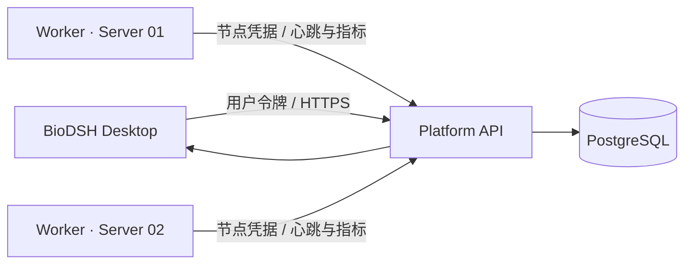

# BioDSH 一对多计算服务器接入与资源监控

## 连接模型

桌面端只配置一个 Platform 地址并登录。Platform 保存服务器登记、节点状态和资源历史；每台计算服务器运行一个 `biodsh-worker`，主动向 Platform 发起 HTTPS 请求。桌面端不会保存服务器 SSH 密码，也不要求每台服务器开放额外的入站端口。



增加第二台或更多服务器时，只需在每台服务器重复安装与注册步骤并使用不同节点名。桌面端会从 `/api/v1/nodes` 自动得到完整节点列表。

## 节点注册与凭据

1. Worker 首次注册使用平台初始化令牌调用 `/api/v1/nodes/register`。
2. Platform 生成该节点独享的高熵令牌，只返回一次，数据库只保存 SHA-256 摘要。
3. Worker 将节点 ID 和节点令牌写入权限为 `0600` 的凭据文件。
4. 后续心跳只能使用节点 ID 与节点令牌。初始化令牌从 Worker 环境中删除。
5. 管理员可以轮换节点令牌；旧令牌立即失效。

不允许多台服务器复制同一份 Worker 凭据。每台服务器必须独立注册。

## Linux 安装

在服务器创建独立系统用户和运行目录，将本仓库或发布包中的 `platform` 安装进虚拟环境：

```bash
sudo useradd --system --home /var/lib/biodsh --create-home biodsh
sudo mkdir -p /opt/biodsh-worker /etc/biodsh /var/lib/biodsh
sudo python3 -m venv /opt/biodsh-worker/.venv
sudo /opt/biodsh-worker/.venv/bin/pip install /path/to/BioDSH/platform
sudo cp deploy/linux/worker.env.example /etc/biodsh/worker.env
sudo chown root:biodsh /etc/biodsh/worker.env
sudo chmod 640 /etc/biodsh/worker.env
sudo chown -R biodsh:biodsh /var/lib/biodsh
```

编辑 `/etc/biodsh/worker.env`，配置 Platform HTTPS 地址、唯一节点名、指标磁盘路径和初始化令牌。然后执行一次注册：

```bash
sudo --user biodsh bash -c \
  'set -a; source /etc/biodsh/worker.env; exec /opt/biodsh-worker/.venv/bin/biodsh-worker enroll'
```

注册成功后从 `worker.env` 删除 `BIODSH_WORKER_BOOTSTRAP_TOKEN`，再验证一次心跳：

```bash
sudo --user biodsh bash -c \
  'set -a; source /etc/biodsh/worker.env; exec /opt/biodsh-worker/.venv/bin/biodsh-worker run --once'
```

最后安装并启动 systemd 服务：

```bash
sudo cp deploy/linux/biodsh-worker.service /etc/systemd/system/
sudo systemctl daemon-reload
sudo systemctl enable --now biodsh-worker
sudo systemctl status biodsh-worker
```

生产环境应使用正式软件包安装流程替代仓库路径，并由部署系统注入环境文件。服务模板默认限制系统写权限，仅允许写入 `/var/lib/biodsh`。

## 资源可视化数据

Worker 默认每 10 秒采集并上报：

- CPU 使用率和 1 分钟负载；
- 内存已用量、总量和百分比；
- 指定数据磁盘的已用量、总量和百分比；
- 网络累计接收与发送字节；
- NVIDIA GPU 型号、利用率、显存和温度；
- 当前运行任务数。

Platform 将数据写入 `node_metrics` 时序表，默认保留 7 天。节点超过 45 秒未上报时，读取接口会将其判定为离线。两个阈值都通过环境变量配置。

桌面端“计算服务器”页面每 10 秒刷新当前指标，并读取最近一小时历史绘制 CPU、内存和磁盘曲线。管理员还可以把节点设置为排空、禁用或重新启用。排空状态将在任务调度阶段用于停止分配新任务，同时允许已有任务结束。

## 当前边界与下一步

本阶段完成的是服务器接入、独立认证、在线状态、资源采集、历史查询和桌面可视化。Worker 暂不执行分析任务，`running_jobs` 当前为 0。下一步应基于同一个 Worker 增加任务领取、资源匹配、受控子进程、日志上传、取消和结果登记；无需改变桌面端到 Platform 的一对多连接模型。
